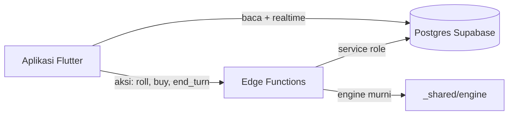
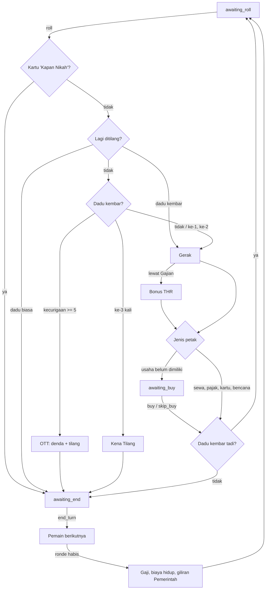

# Negeri Wkwk

Game papan online satire ala monopoli: **rakyat bersatu melawan Pemerintah**. Pemain cari nafkah lewat kerja dan usaha, saling jaga, dan mendorong Reformasi lewat gerakan damai, sambil waspada sama Buzzer yang disusupkan.

Repo ini berisi **backend** (Supabase): skema database, aturan keamanan, engine permainan, dan Edge Functions. Aplikasi Flutter menyusul.

## Arsitektur



- **Klien hanya membaca.** Semua perubahan lewat Edge Function, jadi dadu dan uang nggak bisa dicurangi dari HP.
- **State publik** disimpan utuh di `game_states.state` (jsonb) dengan `version` untuk optimistic locking.
- **Peran rahasia** (Buzzer, Mimpi Pribadi) ada di `player_secrets`. RLS memastikan hanya pemiliknya yang bisa membaca.
- **Event rahasia** di `game_events` diberi `visible_to` supaya cuma orang tertentu yang lihat.

## Alur giliran



Di fase `awaiting_roll` dan `awaiting_end`, pemain juga boleh: `upgrade`, `setor_tabungan`, `donasi_lumbung`, `petisi`, `liputan_media` (maksimal satu aksi gerakan per giliran), dan `bayar_denda` saat ditilang.

**Akhir ronde:** semua pemain terima gaji sesuai profesi, biaya hidup dipotong, Pemerintah mengambil kartu Kebijakan (dua kartu setelah pemilu, bagi-bagi bansos saat Musim Kampanye), dan Meteran Inflasi naik tiap 3 ronde. Pemerintah juga meredam Meter Gerakan tiap ronde, dan makin besar gerakannya makin keras redamannya. Kalau Kesabaran Rakyat habis, terjadi Demo Akbar dan Meter Gerakan naik.

**Menang/kalah (mode Rakyat Bersatu):** menang kalau Meter Gerakan mencapai 100. Kalah kalau 2 pemain bangkrut atau lewat ronde ke-30.

## Struktur folder

```
supabase/
  migrations/20261116000000_init.sql   skema + RLS
  functions/
    _shared/board.json                 40 petak papan (dipakai juga oleh Flutter)
    _shared/engine/                    engine permainan (TypeScript murni)
      types.ts  rules.ts  core.ts  cards.ts  engine.ts  rng.ts  mod.ts
    _shared/http.ts                    auth, CORS, error JSON
    create-room/  join-room/  start-game/  game-action/
  tests/
    engine.test.ts                     unit test + simulasi 1.000 game acak
    rls_test.sql                       uji aturan keamanan
    supabase_stub.sql                  stub auth Supabase untuk uji lokal
    run_db_tests.sh
```

Angka keseimbangan (gaji, sewa, inflasi, denda) ada di `rules.ts`. Ubah di sana saat playtest.

### Hasil simulasi awal

Simulasi 1.500 game, 4 bot, dengan angka di `rules.ts` saat ini:

| Strategi bot | Rakyat menang | Kalah (2 bangkrut) | Kalah (waktu habis) | Rata-rata ronde |
| --- | --- | --- | --- | --- |
| Pasif (cuma beli & jalan) | 0% | 62% | 38% | 25,0 |
| Seimbang (aksi kalau Cuan > 600) | 1% | 77% | 22% | 23,3 |
| Agresif (aksi tiap giliran) | 10% | 88% | 2% | 15,7 |

Sesuai konsep, menang memang susah. Bot ini belum bisa saling menalangi; fitur Patungan, Lumbung untuk talangan, dan Ronda nanti harus menaikkan peluang menang tim yang kompak.

## Menjalankan

Tes engine (Node 22.18+):

```bash
npm test
```

Tes database + RLS (butuh Docker atau PostgreSQL lokal):

```bash
npm run test:db
```

## Deploy ke Supabase

1. Buat project di [supabase.com](https://supabase.com), lalu install [Supabase CLI](https://supabase.com/docs/guides/cli).
2. Di folder repo:
   ```bash
   supabase init          # membuat supabase/config.toml, folder lain tidak diubah
   supabase login
   supabase link --project-ref <project-ref>
   supabase db push       # menjalankan migration
   supabase functions deploy create-room join-room start-game game-action
   ```
3. Aktifkan login (misalnya Google atau email) di Authentication > Providers.

`SUPABASE_URL` dan `SUPABASE_SERVICE_ROLE_KEY` otomatis tersedia di Edge Functions. **Jangan pernah** taruh service role key di aplikasi Flutter.

## API Edge Functions

Semua `POST` dengan header `Authorization: Bearer <access token user>`.

| Function | Body | Hasil |
| --- | --- | --- |
| `create-room` | `{ mode?, maxPlayers?, profession? }` | `{ roomId, code }` |
| `join-room` | `{ code, profession? }` | `{ roomId, seat }` |
| `start-game` | `{ roomId }` (host saja) | `{ version, state }` |
| `game-action` | `{ roomId, version, action }` | `{ version, state, events }` |

Contoh `action`: `{ "type": "roll" }`, `{ "type": "buy" }`, `{ "type": "upgrade", "tile": 6 }`, `{ "type": "donasi_lumbung", "amount": 100 }`.

Error dikembalikan sebagai `{ error: "<kode>", message: "<pesan Bahasa Indonesia>" }`. Kode `state_basi` (409) artinya klien harus memuat ulang state.

Di Flutter, berlangganan perubahan dengan Supabase Realtime pada tabel `game_states` (filter `room_id`) dan `game_events`.

## Belum dibuat (berikutnya)

- Aplikasi Flutter: lobby, papan, animasi dadu, kartu ringkasan akhir match.
- Kemampuan Buzzer (sebar hoaks, sunat donasi), Cek Fakta, dan Sidang Rakyat.
- Aksi gerakan lanjutan: Gugatan ke Mahkamah, Mogok Nasional, Pemilu Rakyat.
- Lumbung untuk menalangi teman, Patungan, Ronda, dan kartu Ordal.
- Timer giliran dan bot untuk pemain yang disconnect.
- Toko Emas Antum (Google Play Billing) dan validasi pembelian di server.
